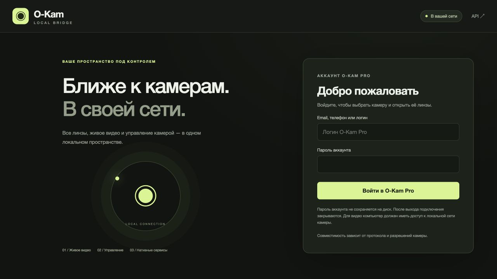

# O-Kam Pro Local Bridge

**Your cameras. Your network. Your API.**

[](CHANGELOG.md)
[](LICENSE)
[](docs/api.md)

A self-hosted dashboard and HTTP API for compatible O-Kam Pro cameras using the CS2/PPPP protocol. View local video, switch lenses, move PTZ cameras, inspect metadata and send validated native controls from one interface.

[Quick start](#quick-start) · [Deployment](docs/deployment.md) · [API](docs/api.md) · [Bridge exports](docs/bridge-exports.md) · [Security](SECURITY.md) · [Русский](README.ru.md)



## What it does

- Browser live view, snapshots, MJPEG and original H.264 output.
- Optional bridge RTSP/TCP publication and ONVIF Device/Media, PTZ, PullPoint events and archive services, with one profile per observed lens.
- Multiple lens views, including three-lens camera layouts where supported.
- High, medium and low native quality selection.
- PTZ, presets, image settings and model-dependent native controls.
- Account camera catalog, redacted metadata and a control console.
- Opt-in server recording with retention/quota, SD-card clip import, authenticated downloads and RTSP replay.
- Separate Python API and static nginx dashboard, with a documented OpenAPI contract.

**Compatibility matters:** this bridge supports the CS2/PPPP transport family, not every camera sold under the O-Kam name. Cameras must be reachable on your LAN or a routed private network. Account login and transport bootstrap contact vendor services; this is not a cloud relay or WAN video transport.

Audio streaming, two-way talk and VP transport are not implemented. Bridge publication copies H.264 without encoding through the separate MediaMTX service (TCP 8554 by default); the optional ONVIF endpoint uses port 8899 and authenticated snapshots. WS-Discovery works only where multicast is reachable. ONVIF supports bounded continuous pan/tilt, native presets, observed status events, recording search and forward clip replay. Absolute PTZ positions, reverse playback and RTSP clock seeking are unsupported; ONVIF certification is not claimed. [Set up bridge exports](docs/bridge-exports.md).

Native camera capability flags do not prove that an RTSP or ONVIF daemon is running. Independent native service toggles remain unverified and disabled; bridge publication does not change the camera’s native ONVIF/RTSP settings.

## Quick start

Use Docker Engine on Linux with Docker Compose. Host networking lets the bridge reach camera UDP discovery and native transport directly.

```sh
git clone https://github.com/nazar220160/O-Kam-Pro-Local-Bridge.git
cd O-Kam-Pro-Local-Bridge
```

Encrypted camera credentials are decoded by the bridge itself. No official PC client, copied executable or extra credentials file is required.

```sh
docker compose up -d
```

Open [localhost:8080](http://localhost:8080), sign in with your O-Kam account, select a camera and connect. The dashboard starts separately from the API; Compose builds both and initializes their private gateway token automatically. No manual gateway token setup is needed.

Default listeners: dashboard `0.0.0.0:8080`, API `127.0.0.1:8098`. The API reference is available through the dashboard at [/docs/](http://localhost:8080/docs/) and [/openapi.json](http://localhost:8080/openapi.json).

The dashboard is reachable at `http://SERVER_IP:8080` on your trusted LAN. Optional `.env` overrides:

```dotenv
WEB_LISTEN=0.0.0.0
WEB_PORT=8080
BRIDGE_PORT=8098
```

Then run `docker compose up -d` again. Read the [deployment guide](docs/deployment.md) before exposing a listener beyond your machine. On **macOS**, run `./start-macos.sh` instead: it starts the camera API natively and the dashboard plus MediaMTX in Docker. Python 3.11+, FFmpeg and Docker Desktop are required. This avoids Docker Desktop NAT dropping replies from cameras' dynamic UDP ports. The same `.env` port settings apply.

`compose.desktop.yaml` is an experimental all-container alternative; explicit camera IP alone does not guarantee UDP reachability through Docker Desktop. Use the native macOS launcher if the camera is unreachable from the VM.

## Native API

Install Python 3.12+, FFmpeg on `PATH`, and the Python dependencies:

```sh
python3 -m venv .venv
. .venv/bin/activate
pip install -r requirements.txt
python -m okam_bridge api --port 8098
```

The API serves JSON and API documentation. The dashboard is the separate `web/` service. Credential decoding is built in; no `--credential-client` argument is needed. See [deployment](docs/deployment.md) for access protection and frontend configuration, and [API examples](docs/api.md) for login, video and controls.

Publication credentials are separate from account, camera and browser-player credentials and appear automatically in selectable text fields when publication is enabled. Closing the dashboard tab keeps an enabled publication running; logout, camera disconnect, disabling publication or API restart revokes it. After restart, sign in and enable it again.

## Project

Independent community software, unaffiliated with O-Kam, VStarcam or their vendors. Firmware and model behavior vary; report reproducible compatibility details without publishing identifiers or secrets.

Contributions are welcome: [CONTRIBUTING.md](CONTRIBUTING.md). MIT licensed; attribution and inherited code are documented in [THIRD_PARTY.md](THIRD_PARTY.md).
